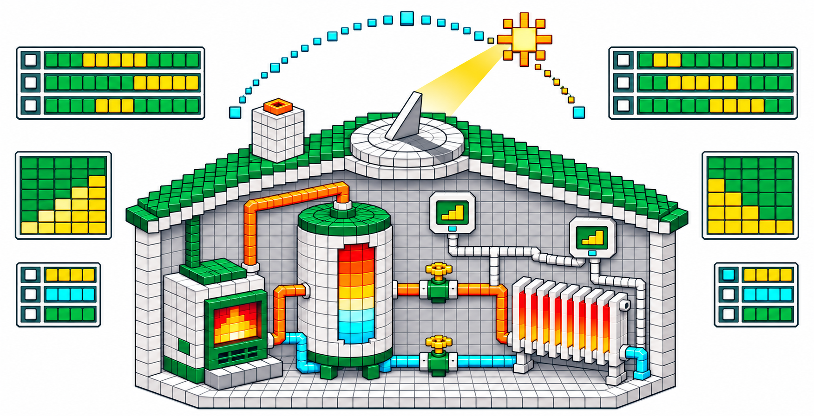

# Ramses



I am building a Home Assistant heating programmer that can replace the current heating controls—when it works well enough for everyone who lives here to accept it.

I want the system to feel calm, clear and dependable. People should be able to see the temperature, the target, the schedule and the next change. They should be able to make a simple temporary change without needing to understand radio packets or controller firmware.

## Prime directive

I use Home Assistant to replace the heating controls to the acceptance of the other people in the house.

I use Lovelace where it provides the clearest everyday interface. I use Home Assistant entities to represent the heating system:

- **Climate entities** show a zone's temperature, target and operating mode.
- **Temperature entities** report room and cylinder temperature.
- **Schedule helpers** hold the weekly heating programme.
- **Status entities** show demand, battery, freshness, boiler interlock and faults.

The UI must explain what is happening. It must not surprise anyone, hide an override, or look like it controls a system when it does not.

## What I am replacing

The long-term aim is to replace the existing physical heating-control hardware with a Home Assistant-centred system. I retain the installed RAMSES-II TRVs. I add cylinder-temperature visibility to the Sunnydays plan. I do not decide the cylinder sensor or wiring arrangement in this repository.

The boiler interlock remains a separate concern. It uses standard 868 MHz RAMSES-II components. I model and test that relationship before I consider replacing any live boiler-control hardware.

## How the parts connect

I use the **Elecram Sub-GHz 855–925 MHz Bridge – ESP32-C6 WiFi/Zigbee** (an ESP32-C6 board with a Sub-GHz radio and Wi-Fi/Zigbee support) as the gateway between the 868 MHz RAMSES-II network and MQTT. It runs [`ramses_esp`](https://github.com/IMMRMKW/ramses_esp).

```text
868 MHz RAMSES-II devices
          |
          v
Elecram bridge + ramses_esp
          |
          v
MQTT broker <-> Home Assistant <-> Ramses test model
```

The board can use Wi-Fi and USB power. It does not need a PC-resident serial bridge. Its gateway ID, Wi-Fi details, broker credentials and Home Assistant token stay out of Git.

For the exact upstream hardware and software references, see [Hardware foundation](docs/hardware-foundation.md): [Elecram](https://elecram.com/), [the board](https://elecram.com/products/esp32-c6-wifi-zigbee-to-855-925mhz-wireless?variant=52605637099853), [ramses_esp](https://github.com/IMMRMKW/ramses_esp), and [ramses_cc](https://github.com/ramses-rf/ramses_cc).

## Prove first

During development, the system must prove itself before it gets a live role.

I prove each behaviour with a clear contract, deterministic tests, bounded observation data, isolated `RAMSES/TEST/...` MQTT traffic and—where people use it—computer-use UI checks. A dashboard mock-up, a decoded radio frame or a working simulation is useful evidence. None of them authorises a live heating change on its own.

For now, this repository is read-only and test-world only. It does not transmit RF, change bindings, reflash the board, modify live MQTT settings or control the boiler.

## Current system map

```text
Controller 487
  Zone 1: Kitchen       -> TRVs 027, 030, 049
  Zone 2: EJMB + RDGB   -> TRVs 389, 048

Controller 751
  Zone 1: Lounge        -> TRVs 472, 387
  Zone 2: CMQ JGB       -> TRV 040

Independent boiler enable: thermostat 226 -> BDR91 642
```

This map records what I have observed. It is not permission to control a device. The evidence lives in [`target-system/`](target-system/).

## What works now

| Area | Where it stands |
| --- | --- |
| Weekly timer | I can model the active target and next scheduled switch with a fixed clock. |
| Temporary and permanent changes | I have a baseline contract and deterministic behaviour tests. |
| Optimum start | I have a model core. It needs real, bounded evidence before it learns from the house. |
| Virtual TRVs | I have the core response model. Some local-override detail remains open. |
| MQTT test transport | The isolated transport core is complete and rejects live MQTT roots. Broker I/O remains deliberately unwired. |
| Home Assistant and Lovelace | Test-only schedule mapping, diagnostics, climate seam and blueprint are staged; the dashboard is not deployed. |
| Live control | Deliberately not started. It needs a separate cutover decision. |

The [delivery breakdown](docs/task-breakdown.md) shows the versioned roadmap. The local `tk` queue records the work in progress.

## Check the project

You need Python 3.11+ and PowerShell. Local checks do not need a broker, radio board or Home Assistant.

```powershell
py -m pip install -e ".[dev]"
.\scripts\check.ps1
```

The gate scans for secrets, checks the documentation review structure, compiles the code, and runs unit and test-world integration checks. It does not connect to the house.

## Read the right document

| Question | Start here |
| --- | --- |
| What should the programmer do? | [Programmer Contract](docs/programmer-contract.md) |
| How will people use the future Test View? | [Ramses Test user guide](docs/user-guide.md) |
| What is the Test View blueprint and how will its UI be accepted? | [Dashboard contract](docs/lovelace-ui-contract.md) and [computer-use acceptance runbook](docs/test-view-computer-use-runbook.md) |
| What am I trying to achieve? | [System objectives](docs/system-objectives.md) |
| How do the parts fit together? | [System architecture](docs/system-architecture.md) |
| What crosses the MQTT boundary? | [Test transport contract](docs/contract.md) |
| How do I collect observations without growing logs forever, and when do they prove behaviour? | [Ingest contract](docs/ingest-contract.md), [scenario recording](docs/scenario-recording.md) and [scenario qualification](docs/scenario-qualification.md) |
| How do I make, review and roll back a change? | [Repository contract](docs/repository-contract.md) and [change management](docs/change-management.md) |
| What decisions are already made? | [ADRs](docs/adr/) |
| What can another agent rely on? | [Skills inventory](docs/skills-inventory.md) and [repertoire](docs/repertoire/index.md) |
| Where is every document? | [Documentation map](docs/README.md) |

The Markdown user guide is the source of truth. The future Home Assistant Help view will render the same material. It will not be the only copy.

## Work on the project

1. Read [`AGENTS.md`](AGENTS.md). Claim one ready `tk` task.
2. Keep the change small. Record dependencies before parallel work begins.
3. Update the relevant contract, architecture, evidence map, ADR or user guide.
4. Add deterministic tests for state, schedules, overrides, encoding and transport changes.
5. Add an adversarial review for model, data, scenario, transport, CI or deployment changes.
6. Run `.\scripts\check.ps1`. Review the diff. Commit and push.

I use revert commits for shared history. I do not rewrite published experiment history.

## Visual assets

I use the high-fidelity [PNG ident](assets/ident/explorations/voxel-house-white-v4.png) here. It is a bright, pure-white metaphor for time affecting a physical heating loop. The editable [SVG](assets/ident/voxel-house-white.svg), prompt history and review notes live in [`assets/ident/`](assets/ident/). They are design assets, not a dashboard or live-system diagram.
