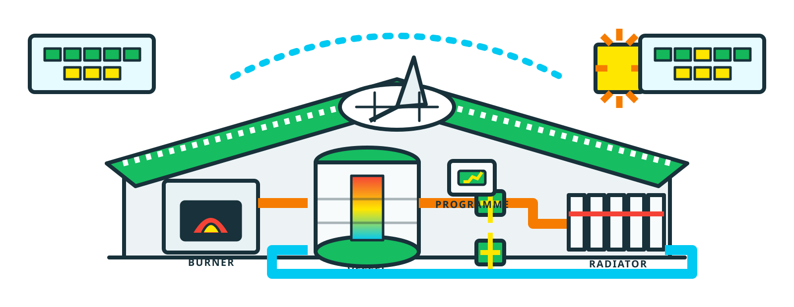

# Ramses — heating programmer digital twin



Ramses is a **software-only digital twin** of an observed Honeywell RAMSES-II heating network. Its strategic target is replacement of the existing physical heating-control hardware while retaining the installed TRVs and hot-water-cylinder temperature gauge. It is the engineering workspace for proving that replacement in software before anyone changes a live controller, valve binding, gateway setting, or boiler circuit.

> **Current status: experimental, read-only and test-world only.** The model, timer, temporary/permanent overrides, optimiser core, virtual TRV behaviour and contract tests exist. The live installation remains the authority; this repository must not transmit RF or publish to the live MQTT root.

## Why this exists

The goal is not to casually replace working heating controls. It is to establish a repeatable evidence chain:

1. Observe bounded RAMSES-II traffic from the existing system.
2. Model the timer, target precedence, virtual devices and thermal response.
3. Exercise the model exclusively through `RAMSES/TEST/...` MQTT topics.
4. Compare simulated scenarios with ordered passive captures.
5. Only then make a separately reviewed RF decision.

The [Programmer Contract](docs/programmer-contract.md) defines the user-visible behaviour we want Home Assistant to reproduce. The Evohome controller guide is a behavioural reference; it is not copied firmware or a claim that undocumented RF behaviour has been replicated.

## Hardware foundation

This experiment is predicated on the **Elecram Sub‑GHz 855–925 MHz Bridge – ESP32‑C6 WiFi/Zigbee**, running the `ramses_esp` firmware. It is the physical RAMSES-II receiver/gateway boundary: it observes the radio network and exposes the testable MQTT interface that the software model mirrors.

- Hardware producer: [Elecram](https://elecram.com/) — an independent shop created by [Marcel](https://elecram.com/pages/about).
- Board: [Elecram Sub‑GHz 855–925 MHz Bridge – ESP32‑C6 WiFi/Zigbee](https://elecram.com/products/esp32-c6-wifi-zigbee-to-855-925mhz-wireless?variant=52605637099853).
- Gateway firmware and configuration reference: [IMMRMKW/ramses_esp](https://github.com/IMMRMKW/ramses_esp).
- Software protocol and Home Assistant integration reference: [ramses-rf/ramses_cc](https://github.com/ramses-rf/ramses_cc).

The board may be USB-powered and connect to the broker over Wi-Fi; it does not require a PC-resident serial bridge. Its individual gateway ID, Wi-Fi credentials, broker password and Home Assistant token are intentionally excluded from this repository. The model uses a separate `RAMSES/TEST/...` namespace, never the live board’s control path.

## Safety boundary

| This repository does | This repository does not do |
| --- | --- |
| Models timers, overrides, TRVs, schedule targets and thermal behaviour. | Transmit RF, alter a gateway, bind devices, or alter live heating. |
| Uses the isolated `RAMSES/TEST/...` test namespace. | Read from or write to `RAMSES/GATEWAY/...` from simulator code. |
| Stores bounded, sanitised observation fixtures. | Store credentials, tokens, Home Assistant configuration, or unbounded logs. |
| Produces an eventual Home Assistant **Test View** and help content. | Claim that an illustration, dashboard mock-up, or test entity controls the house. |

If an apparent test action could affect the live system, stop and investigate it; that is a defect in the experiment boundary.

## Target system — current observed map

```text
Controller 487
  Zone 1: Kitchen       -> TRVs 027, 030, 049
  Zone 2: EJMB + RDGB   -> TRVs 389, 048

Controller 751
  Zone 1: Lounge        -> TRVs 472, 387
  Zone 2: CMQ JGB       -> TRV 040

Independent boiler enable: thermostat 226 -> BDR91 642
```

This is topology evidence, not a promise of device control. The canonical evidence map and its sources live in [`target-system/`](target-system/).

## System at a glance

```text
Home Assistant Test View
          | schedule / temporary override / diagnostics
          v
  Programmer + zone coordinator + optimiser
          | only structured test frames
          v
RAMSES/TEST/<gateway-id>/{tx,rx} MQTT boundary
          |
          v
Virtual CM67z controllers <-> Virtual TRVs <-> Virtual BDR response

Live RF and RAMSES/GATEWAY/... remain outside the system.
```

For responsibilities, state ownership, persistence and the trust boundary, see the [system architecture](docs/system-architecture.md) and the [test transport contract](docs/contract.md).

## What works today

| Area | State | Evidence |
| --- | --- | --- |
| Weekly timer and target selection | Implemented | Fixed-clock tests for active and next switchpoints. |
| Zone and whole-system override rules | Baseline modelled | [Programmer Contract](docs/programmer-contract.md); unresolved semantics remain explicitly queued. |
| Thermal/optimum-start core | Implemented, evidence not yet calibrated | Deterministic model tests; no live learning/control. |
| Virtual TRV response | Core implemented | Unit tests; local-override expiry still requires contract resolution. |
| MQTT test transport | Planned next | Must reject non-test roots at runtime. |
| Home Assistant entities/cards | Planned and test-only | No live HA control path exists here. |
| RF validation/cutover | Blocked by design | Requires a separate ADR and explicit approval. |

The [delivery breakdown](docs/task-breakdown.md) is the versioned roadmap; the local `tk` queue records active, delegated work.

## Run the verification gate

Requirements: Python 3.11+ and PowerShell. The project has no broker, radio, or Home Assistant dependency for its local tests.

```powershell
py -m pip install -e ".[dev]"
.\scripts\check.ps1
```

The gate runs a secret scan, documentation-review validation, compilation, deterministic unit tests and test-world integration fixtures. It must pass before a commit. It never connects to the private Home Assistant or MQTT network.

## Documentation

Start here according to the question you need answered:

| Need | Canonical document |
| --- | --- |
| What must the programmer do for a user? | [Programmer Contract](docs/programmer-contract.md) |
| How will a user operate the future test dashboard? | [Ramses Test user guide](docs/user-guide.md) |
| What is in and out of scope? | [System objectives](docs/system-objectives.md) |
| How do the model, MQTT boundary and virtual devices fit together? | [System architecture](docs/system-architecture.md) |
| What frames cross the simulated radio boundary? | [Test transport contract](docs/contract.md) |
| What physical board and firmware anchor the observed gateway boundary? | [Hardware foundation](docs/hardware-foundation.md) |
| How are observations acquired without log growth? | [Ingest contract](docs/ingest-contract.md) and [scenario recording](docs/scenario-recording.md) |
| How are tests, reviews, commits and rollback managed? | [Repository contract](docs/repository-contract.md), [test contracts](docs/test-contracts.md), [change management](docs/change-management.md) |
| What has been decided and why? | [ADRs](docs/adr/) |
| What can agents depend on? | [Skills inventory](docs/skills-inventory.md) and [repertoire](docs/repertoire/index.md) |
| Where is the complete document index? | [Documentation map](docs/README.md) |

The Markdown user guide is canonical. A future Home Assistant Help subview will render the same content; it will never be the sole copy of the documentation.

## Contributing and releasing

1. Read [`AGENTS.md`](AGENTS.md), then claim one ready `tk` task.
2. Keep one observable change per task. Record dependencies before delegating parallel work.
3. Update the relevant contract, architecture, target-system evidence, ADR or user guide with the change.
4. Add deterministic tests for all state, schedule, override, encoding and transport changes.
5. Add an adversarial review in [`docs/reviews/`](docs/reviews/) for model, data, scenario, transport, CI or deployment changes.
6. Run `.\scripts\check.ps1`, inspect the diff, make a scoped commit, then push.

For shared history, use a revert commit rather than rewriting published history. The detailed workflow and rollback rules are in the [repository contract](docs/repository-contract.md).

## Visual identity assets

The README uses the accessible, hand-authored [SVG ident](assets/ident/voxel-house-white.svg): bright, pure white, editable and source-reviewable. The higher-fidelity raster reference, its generations, prompt history and visual/adversarial review are kept under [`assets/ident/`](assets/ident/). The image is a metaphor for time influencing a physical heating loop; it is not a dashboard or live-system diagram.
