# Logical Home Assistant system

Logical responsibilities only. This diagram does not describe configuration, network addresses, credentials, or live heating authority.

## Legacy heating and target digital twin

Home Assistant unifies household interfaces and observes the RAMSES heating system. Direct heating authority remains evidence-gated.

```mermaid
flowchart LR
  accTitle: Legacy heating and target digital twin
  accDescr: A left-to-right logical diagram of household interfaces, Home Assistant, lighting, the passive RAMSES bridge, the legacy heating estate, and the test-world digital twin.
  mobile["HA mobile app&#92;naccess and identity"]
  class mobile interface
  alexa["Alexa"]
  class alexa interface
  nspanel["NSPanel"]
  class nspanel interface
  ha["Home Assistant&#92;nRaspberry Pi household controller"]
  class ha core
  zigbee["Sonoff Zigbee radio&#92;nlighting system"]
  class zigbee household
  elecram["Elecram bridge&#92;npassive RAMSES observation"]
  class elecram observe
  legacy["Legacy heating estate&#92;nCM67z x2, BDR91, V4073, TRVs, cylinder"]
  class legacy legacy
  twin["Room and system digital twin&#92;nRAMSES contract model and evidence"]
  class twin test
  future["Future direct zone and boiler tasking&#92;nevidence-gated only"]
  class future future
  mobile -->|household access| ha
  alexa -->|voice| ha
  nspanel -->|physical navigation| ha
  ha -->|lighting| zigbee
  legacy -->|bounded RX only| elecram
  elecram -->|observed state| ha
  ha -->|test-world schedule and model| twin
  twin -.->|only after evidence gate| future
classDef interface fill:#e8f1fb,stroke:#326a9b,color:#132b40
classDef core fill:#d8f3e5,stroke:#26734d,color:#103a26
classDef household fill:#fff3cd,stroke:#926b00,color:#503c00
classDef observe fill:#f1edff,stroke:#6650a4,color:#31266a
classDef legacy fill:#f7e7e7,stroke:#985454,color:#542323
classDef test fill:#e7f5f7,stroke:#267b86,color:#16444a
classDef future fill:#f2f2f2,stroke:#6a6a6a,color:#333333
%% portable-canonical-v2:eyJhY2Nlc3NpYmlsaXR5IjoiQSBsZWZ0LXRvLXJpZ2h0IGxvZ2ljYWwgZGlhZ3JhbSBvZiBob3VzZWhvbGQgaW50ZXJmYWNlcywgSG9tZSBBc3Npc3RhbnQsIGxpZ2h0aW5nLCB0aGUgcGFzc2l2ZSBSQU1TRVMgYnJpZGdlLCB0aGUgbGVnYWN5IGhlYXRpbmcgZXN0YXRlLCBhbmQgdGhlIHRlc3Qtd29ybGQgZGlnaXRhbCB0d2luLiIsImRhdGEiOnsiZGlyZWN0aW9uIjoiTFIiLCJlZGdlcyI6W3siYXJyb3ciOiItLT4iLCJmcm9tIjoibW9iaWxlIiwibGFiZWwiOiJob3VzZWhvbGQgYWNjZXNzIiwidG8iOiJoYSJ9LHsiYXJyb3ciOiItLT4iLCJmcm9tIjoiYWxleGEiLCJsYWJlbCI6InZvaWNlIiwidG8iOiJoYSJ9LHsiYXJyb3ciOiItLT4iLCJmcm9tIjoibnNwYW5lbCIsImxhYmVsIjoicGh5c2ljYWwgbmF2aWdhdGlvbiIsInRvIjoiaGEifSx7ImFycm93IjoiLS0-IiwiZnJvbSI6ImhhIiwibGFiZWwiOiJsaWdodGluZyIsInRvIjoiemlnYmVlIn0seyJhcnJvdyI6Ii0tPiIsImZyb20iOiJsZWdhY3kiLCJsYWJlbCI6ImJvdW5kZWQgUlggb25seSIsInRvIjoiZWxlY3JhbSJ9LHsiYXJyb3ciOiItLT4iLCJmcm9tIjoiZWxlY3JhbSIsImxhYmVsIjoib2JzZXJ2ZWQgc3RhdGUiLCJ0byI6ImhhIn0seyJhcnJvdyI6Ii0tPiIsImZyb20iOiJoYSIsImxhYmVsIjoidGVzdC13b3JsZCBzY2hlZHVsZSBhbmQgbW9kZWwiLCJ0byI6InR3aW4ifSx7ImFycm93IjoiLS4tPiIsImZyb20iOiJ0d2luIiwibGFiZWwiOiJvbmx5IGFmdGVyIGV2aWRlbmNlIGdhdGUiLCJ0byI6ImZ1dHVyZSJ9XSwibm9kZXMiOlt7ImNsYXNzIjoiaW50ZXJmYWNlIiwiaWQiOiJtb2JpbGUiLCJsYWJlbCI6IkhBIG1vYmlsZSBhcHBcXG5hY2Nlc3MgYW5kIGlkZW50aXR5In0seyJjbGFzcyI6ImludGVyZmFjZSIsImlkIjoiYWxleGEiLCJsYWJlbCI6IkFsZXhhIn0seyJjbGFzcyI6ImludGVyZmFjZSIsImlkIjoibnNwYW5lbCIsImxhYmVsIjoiTlNQYW5lbCJ9LHsiY2xhc3MiOiJjb3JlIiwiaWQiOiJoYSIsImxhYmVsIjoiSG9tZSBBc3Npc3RhbnRcXG5SYXNwYmVycnkgUGkgaG91c2Vob2xkIGNvbnRyb2xsZXIifSx7ImNsYXNzIjoiaG91c2Vob2xkIiwiaWQiOiJ6aWdiZWUiLCJsYWJlbCI6IlNvbm9mZiBaaWdiZWUgcmFkaW9cXG5saWdodGluZyBzeXN0ZW0ifSx7ImNsYXNzIjoib2JzZXJ2ZSIsImlkIjoiZWxlY3JhbSIsImxhYmVsIjoiRWxlY3JhbSBicmlkZ2VcXG5wYXNzaXZlIFJBTVNFUyBvYnNlcnZhdGlvbiJ9LHsiY2xhc3MiOiJsZWdhY3kiLCJpZCI6ImxlZ2FjeSIsImxhYmVsIjoiTGVnYWN5IGhlYXRpbmcgZXN0YXRlXFxuQ002N3ogeDIsIEJEUjkxLCBWNDA3MywgVFJWcywgY3lsaW5kZXIifSx7ImNsYXNzIjoidGVzdCIsImlkIjoidHdpbiIsImxhYmVsIjoiUm9vbSBhbmQgc3lzdGVtIGRpZ2l0YWwgdHdpblxcblJBTVNFUyBjb250cmFjdCBtb2RlbCBhbmQgZXZpZGVuY2UifSx7ImNsYXNzIjoiZnV0dXJlIiwiaWQiOiJmdXR1cmUiLCJsYWJlbCI6IkZ1dHVyZSBkaXJlY3Qgem9uZSBhbmQgYm9pbGVyIHRhc2tpbmdcXG5ldmlkZW5jZS1nYXRlZCBvbmx5In1dfSwiZGVzY3JpcHRpb24iOiJIb21lIEFzc2lzdGFudCB1bmlmaWVzIGhvdXNlaG9sZCBpbnRlcmZhY2VzIGFuZCBvYnNlcnZlcyB0aGUgUkFNU0VTIGhlYXRpbmcgc3lzdGVtLiBEaXJlY3QgaGVhdGluZyBhdXRob3JpdHkgcmVtYWlucyBldmlkZW5jZS1nYXRlZC4iLCJpZCI6ImxvZ2ljYWxfaGFfc3lzdGVtIiwia2luZCI6ImZsb3djaGFydCIsInNvdXJjZVNoYTI1NiI6IjBhMTRhZDI1ZThmN2NjYTIzYmFiMGIxMWI5MTA3MWI5OGJlMjI1YTEzYjhlOWFhZTg3Nzg1N2E2ZDUyYjkzYzUiLCJzdHlsZXMiOlt7ImRlZmluaXRpb24iOiJmaWxsOiNlOGYxZmIsc3Ryb2tlOiMzMjZhOWIsY29sb3I6IzEzMmI0MCIsIm5hbWUiOiJpbnRlcmZhY2UifSx7ImRlZmluaXRpb24iOiJmaWxsOiNkOGYzZTUsc3Ryb2tlOiMyNjczNGQsY29sb3I6IzEwM2EyNiIsIm5hbWUiOiJjb3JlIn0seyJkZWZpbml0aW9uIjoiZmlsbDojZmZmM2NkLHN0cm9rZTojOTI2YjAwLGNvbG9yOiM1MDNjMDAiLCJuYW1lIjoiaG91c2Vob2xkIn0seyJkZWZpbml0aW9uIjoiZmlsbDojZjFlZGZmLHN0cm9rZTojNjY1MGE0LGNvbG9yOiMzMTI2NmEiLCJuYW1lIjoib2JzZXJ2ZSJ9LHsiZGVmaW5pdGlvbiI6ImZpbGw6I2Y3ZTdlNyxzdHJva2U6Izk4NTQ1NCxjb2xvcjojNTQyMzIzIiwibmFtZSI6ImxlZ2FjeSJ9LHsiZGVmaW5pdGlvbiI6ImZpbGw6I2U3ZjVmNyxzdHJva2U6IzI2N2I4Nixjb2xvcjojMTY0NDRhIiwibmFtZSI6InRlc3QifSx7ImRlZmluaXRpb24iOiJmaWxsOiNmMmYyZjIsc3Ryb2tlOiM2YTZhNmEsY29sb3I6IzMzMzMzMyIsIm5hbWUiOiJmdXR1cmUifV0sInRpdGxlIjoiTGVnYWN5IGhlYXRpbmcgYW5kIHRhcmdldCBkaWdpdGFsIHR3aW4iLCJ2ZXJzaW9uIjoxfQ
```

<!-- mermaid:id=logical_ha_system -->

