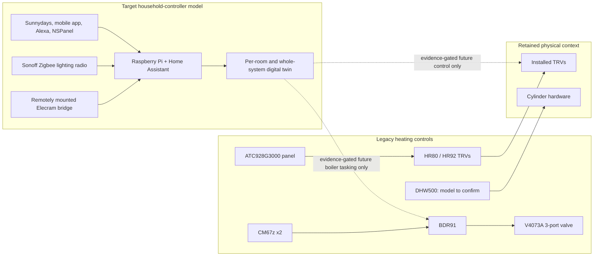

# Hardware visual inventory

This is a source-linked visual inventory for the heating experiment. It gives
maintainers a consistent vocabulary for diagrams and documentation. It is not a
wiring diagram, installation guide, device configuration, or authority to
control equipment.

## Image and source policy

Use an original, editable system diagram in this repository. Link to a
manufacturer or archival source when a recognisable product photo is useful.
Do not copy third-party product photographs into Git unless their licence or
permission is recorded with the asset. A source link identifies a device; it
does not imply endorsement or grant reuse rights.

## Legacy heating hardware

| Item | Logical role | Visual/source reference | Identification state |
| --- | --- | --- | --- |
| Honeywell Home BDR91 | RF relay in the boiler-enable path | [Resideo BDR91A1000](https://homecomfort.resideo.com/sites/Ukraine/uk-UA/Pages/Product.aspx?cat=HW-TOEM&catpath=1.2.1.2.2&pid=BDR91A1000%28HW%29) | Observed family; exact installed suffix should be checked on the label. |
| Honeywell HR80 | Older radiator controller | [archival Honeywell catalogue](https://spb.ismark.ru/cat/admin/doc/ssanteh_ru_73.pdf) | Legacy reference only; do not reuse its image without permission. |
| Honeywell Home HR92 | Radiator controller | [Resideo HR92](https://www.resideo.com/emea/en/products/comfort/radiator-valves-and-thermostats/radiator-thermostats/hr92-radiator-controller-hr92/) | Product family identified. |
| Honeywell Home V4073A | Three-port mid-position valve | [Resideo V4073](https://customer.resideo.com/products/p-v4073) | `3PV` is treated as a shorthand only. Confirm the exact V4073A suffix and 22/28 mm size on the valve. |
| Honeywell CM67z x2 | Existing programmed room controllers | [archival installation reference](https://www.mytub.co.uk/product_images/honeyen0r8534ge51r0303.pdf) | Two units are part of the stated legacy topology. |
| Honeywell Home ATC928G3000 | Evohome 3000-series touchscreen panel | [Resideo ATC928G3000](https://www.resideo.com/emea/en/products/comfort/thermostats/smart-thermostats/atc928g3000-evohome-connected-controller-spare-only-atc928g3000/) | Product family identified. |
| `DHW500` | Domestic-hot-water cylinder or associated item | [Sonnenkraft DHW cylinder family reference](https://thema-sa.be/skf_pdf/dc/ft_DHW.pdf) | **Provisional.** Confirm the maker and model plate before naming, depicting, or assigning a role. |

## Retained and target-side hardware

| Item | Logical role | Visual/source reference | Identification state |
| --- | --- | --- | --- |
| Installed TRVs | Per-room actuator and local temperature source | HR80/HR92 references above | Retained while the model and communication contract are evidenced. |
| Cylinder hardware | Existing DHW storage and temperature context | `DHW500` reference above | Retained; sensor arrangement is not yet decided. |
| Raspberry Pi | Home Assistant household-controller host | [Raspberry Pi product family](https://www.raspberrypi.com/products/) | Exact model is unrecorded. |
| Elecram ESP32-C6 Sub-GHz bridge | Passive RAMSES-II observation and MQTT boundary | [Elecram board](https://elecram.com/products/esp32-c6-wifi-zigbee-to-855-925mhz-wireless?variant=52605637099853) | Remotely mounted; live configuration stays private. |
| Sonoff Zigbee radio | Lighting-network coordinator/radio | [Sonoff ZBDongle-P family](https://sonoff.tech/products/sonoff-zigbee-3-0-usb-dongle-plus-zbdongle-p) | Exact Sonoff model is unrecorded. |

## Logical transition map

The dashed relationships are planned validation boundaries, not live commands.
Home Assistant must prove the room models and whole-system communication
contract against evidence before any TRV or boiler-control responsibility is
transferred.

## Maintenance

When an installed label is photographed or verified, replace its provisional
entry with the exact manufacturer/model reference. Update the source link and
the diagram together; do not infer a physical wiring, binding, or control path
from a product photograph.
